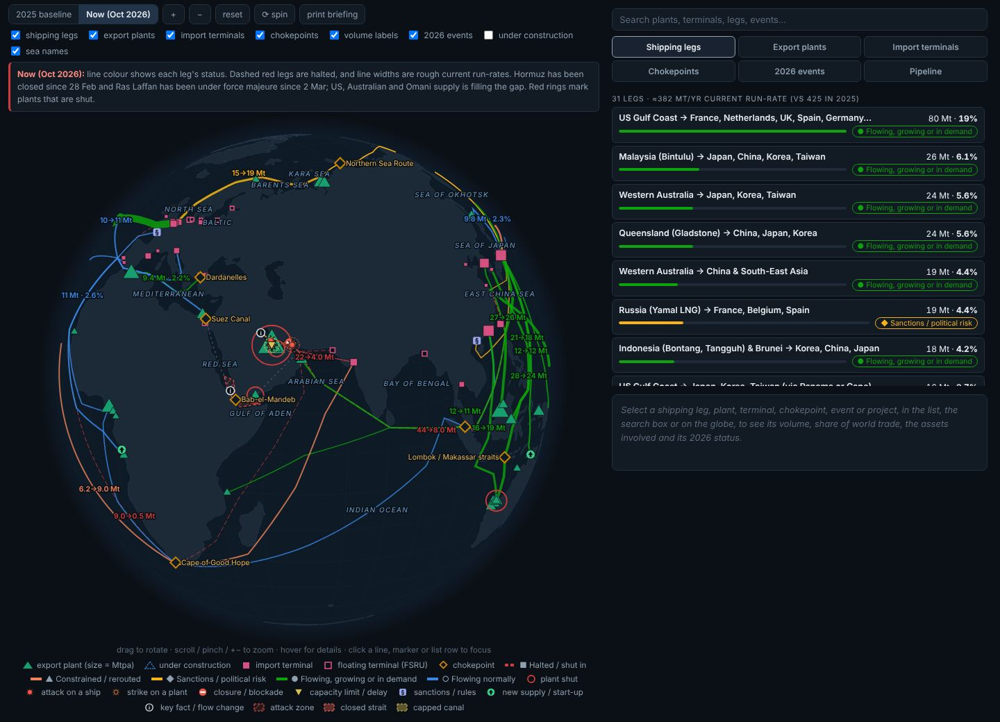
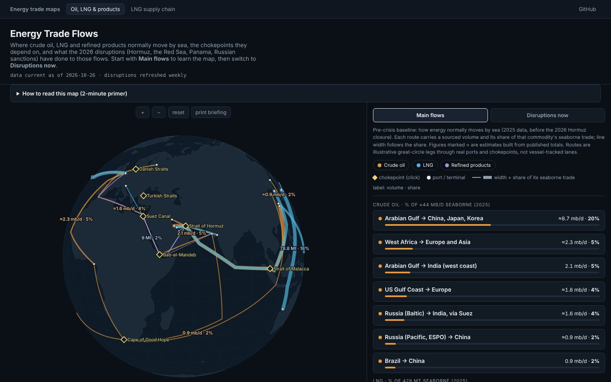
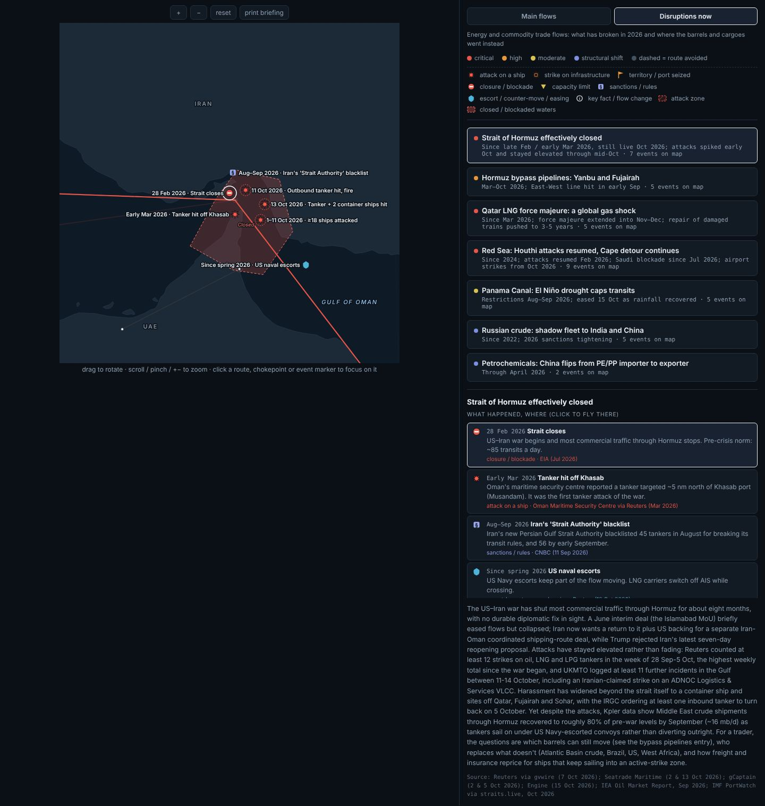
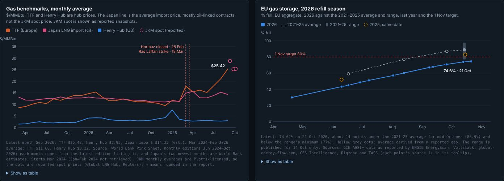
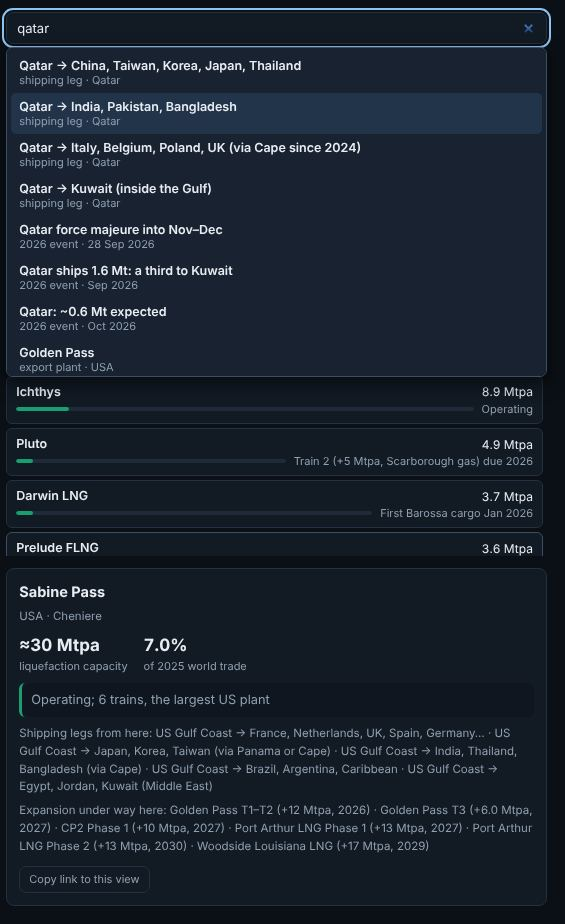
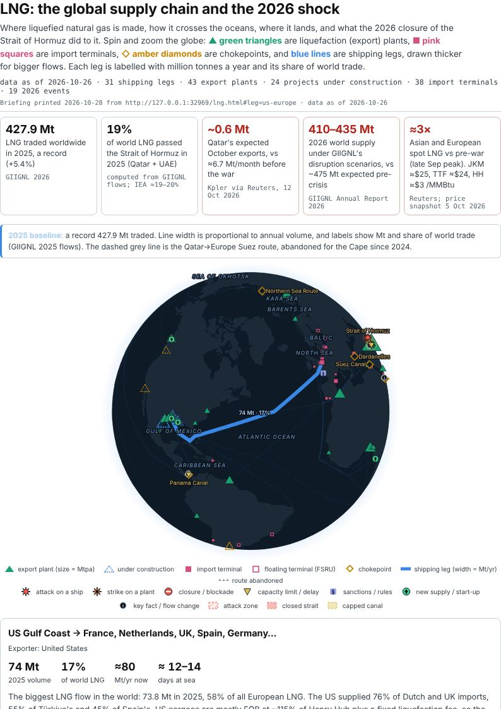
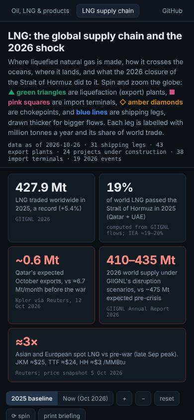

# Energy Trade Flows

**Live:** https://jskifterj.github.io/trade-flow-disruptions/

Two interactive globes covering how oil, LNG and refined products move by sea, and what the 2026 disruptions (the Hormuz closure, Qatar's LNG force majeure, the Red Sea, Panama, Russian sanctions) did to those flows. Every number on the page has a cited source in `data/*.json`. Estimates are marked ≈.



## The two pages

### Oil, LNG & products (`index.html`)



- **Main flows** is the pre-crisis (2025) map: 14 major crude, LNG and product routes and 8 clickable chokepoints (Hormuz, Malacca, Bab-el-Mandeb, Suez, the Cape, Panama, the Turkish and Danish straits).
  - Each route is labelled with a sourced volume (mb/d for oil, Mt for LNG) and its share of that commodity's seaborne trade, and its line width follows that share.
  - Each chokepoint shows its oil flow (EIA, H1 2025), its share of seaborne oil, and why a trader cares.
  - LNG route volumes are sums of the LNG page's GIIGNL legs, so the two pages agree.
- **Disruptions now** covers what 2026 broke and where the barrels went: the Hormuz closure and the bypass pipelines, Qatar's force majeure, the renewed Red Sea attacks, Panama drought limits, the Russian shadow fleet, and one petrochemicals structural shift. Each disruption has its own map layer: dated incidents, shaded attack or closure zones, and sea names.



### LNG supply chain (`lng.html`)

A zoomable globe of the LNG supply chain:

- 43 liquefaction plants, 38 import terminals and FSRUs, 9 chokepoints and 31 shipping legs.
- Each leg is labelled with Mt/yr and its share of world trade (427.9 Mt in 2025).
- A **2025 baseline / Oct 2026** toggle shows the Hormuz/Qatar shock.

The numbered sections below the globe are:

1. The value chain, from gas field to burner tip, with an illustrative cost stack.
2. Exporters, importers, chokepoint exposure and the 2026 supply hole.
3. The 2026–31 supply wave and GIIGNL's 2026 scenarios.
4. **Prices and storage**: monthly TTF, Henry Hub and Japan LNG import prices since March 2024 (World Bank Pink Sheet), with reported JKM spot prints, and EU storage in the 2026 refill season against the 2021–25 range (GIE AGSI+ as reported).

   

5. **Fleet and freight**: Spark spot charter prints for 2024–26, IGU carrier deliveries and orderbook, and the 2026 tonne-mile effect computed from the map's legs.
6. **The import side**: 2025 regas utilisation for 17 countries, EU terminal utilisation for 2021–Q1 2026, and the 13 European FSRUs started or due since 2022.
7. **Voyage calculator**: route any plant to any terminal over the map's sea lanes, open or close Hormuz, the Red Sea, Panama and the Arctic, and compare distance, days, ships needed and freight. The charter default is the latest sourced spot rate and the Panama toll is the ACP tariff.
8. **Arbitrage**: where a US FOB cargo goes, given JKM, TTF, freight and the canal.
9. The timeline, then the primer, glossary and conversions.

Data is in `data/lng.json`, `data/prices.json` and `data/fleet.json`. Leg-level splits and 2026 run-rates are estimates, marked ≈.

## Using it

- **Globe.** Drag to rotate. Scroll, pinch or use **+ / −** to zoom. Hover for details. Click a line, marker or list row to focus on it, and click it again to deselect.
- **Search** (LNG page). The box above the lists finds any plant, terminal, leg, chokepoint, 2026 event or project by name, country, owner or type: try "qatar", "fsru" or "golden pass". Use ↑/↓ to move through the results, Enter to fly there and Esc to close.

  

- **Table view.** Every chart on the LNG page has a **Show as table** toggle underneath it. The table holds the same numbers with their sources, so you can read a value without hovering, use it with a screen reader, or paste it into a spreadsheet.
- **Keyboard.** Tab reaches every list row, card and voyage-table row. Enter or Space selects, and ↑/↓ moves between rows. In the tab strips, ←/→, Home and End switch tabs. Focus stays on the row you selected while the list redraws.
- **Print briefing.** The **print briefing** button (or Ctrl/Cmd+P) prints a light layout without the controls. On the LNG page it includes the KPIs, the globe as you left it, the selected item's detail, every chart, the voyage and arbitrage results, the timeline and the primer. A header line stamps the date and the link to the exact view. "Save as PDF" gives you a handout.

  

### Deep links

The address bar always mirrors the current view, so you can copy it, or use **Copy link to this view** in the detail panel, to share exactly what you are looking at. Opening a link restores the view. Editing the hash in an open tab moves the view too. Unknown values are dropped.

| Page | Hash | Opens |
|---|---|---|
| `lng.html` | `#leg=us-europe` | a shipping leg (ids as in `data/lng.json` → `legs`) |
| | `#plant=sabine-pass`, `#terminal=dahej`, `#project=golden-pass-t1-t2` | a plant, terminal or project, by name slug (a bracketed suffix can be left off: `#plant=ras-laffan`) |
| | `#choke=hormuz` | a chokepoint |
| | `#event=3` | the 3rd 2026 event, counting oldest first (1-based) |
| | `#scenario=2026` | the Oct-2026 view (combine with any of the above using `&`) |
| | `#from=ras-laffan&to=tokyo-bay-terminals&open=hormuz,panama` | the voyage calculator with that route drawn and those passages open (`open=none` closes them all) |
| `index.html` | `#route=gulf-china`, `#choke=hormuz` | a main-flows route or chokepoint |
| | `#disruption=redsea-2026` | a disruption, in the Disruptions view |
| | `#disruption=redsea-2026&event=2` | one incident on that disruption's map (1-based) |
| | `#view=disruptions` | the Disruptions view with nothing selected |

On a phone the page stacks into one column: the globe, then the search, lists and detail panel, then the charts. Charts are redrawn at the screen's width so their text stays readable at 390 px.



## Running it locally

This is a static page with no build step. Fetching `data/*.json` over `file://` is blocked by the browser's CORS policy, so serve it over HTTP:

```
python -m http.server 8080
# then open http://localhost:8080
```

## Testing

Two checks, both run by `npm test` (Node 18+):

```
npm install
npx playwright install chromium   # skip if a Chromium is already installed for Playwright
npm test            # = npm run validate && npm run smoke
npm run validate    # data checks only, no browser, ~1 s
npm run shots       # the smoke tests, also refreshing the README images in docs/img/
```

If the Chromium installed on your machine doesn't match the pinned Playwright build, point the tests at it: `PW_CHROMIUM=/path/to/chrome npm run smoke`.

**Data validation.** `scripts/validate.mjs` checks the four data files and exits non-zero on any error:

- **Schema:** required fields on every leg, plant, terminal, project, chokepoint, event, zone and route; unique ids; every named point in a leg path or `extraLanes` exists in `points`; lat/lon in range; dates are `YYYY-MM-DD`.
- **Allowed values:** leg statuses, event types, zone kinds, project groups, severities and route sizes must match the ones the pages can draw. These sets are read from `lng.js` and `app.js` (`STATUS`, `EVENT`, `ZONE_STYLE`, `GROUP`, `SEV_HEX`, `SIZE_WIDTH`), so they don't drift.
- **Deep links:** plant, terminal and project names must give unique link slugs within their kind.
- **Main flows:** every route has a `flow` with a positive value in its commodity's unit (mb/d for crude and products, Mt for LNG), a period, a basis and a source. Each commodity's routes add up to no more than 100% of its seaborne total. Every LNG route equals the sum of the `lng.json` legs it names (±0.05 Mt), and the LNG total matches `globalTrade2025Mt`. Chokepoint oil flows are sourced and below the seaborne oil total.
- **Sources:** every event on both pages, every LNG leg and chokepoint, and every main-page route and chokepoint needs a `source`.
- **Map layer:** every route in `disruptions.json` must keep `focus`, `events`, `zones` and `regions`, so a weekly refresh can't silently drop them.
- **Prices:** `data/prices.json` months are consecutive `YYYY-MM`, and every price is a positive $/MMBtu value with its Pink Sheet edition. Every JKM print and storage point has a date and source, storage values are percentages, and the 2026 storage series is in date order.
- **Regas capacity:** `regasCapacity` in `data/lng.json`.
  - Every country capacity has a unit (Mtpa or bcm), an as-of date, a confidence level and a source, plus 2025 imports to divide by, and its implied utilisation must be between 5% and 105%.
  - EU utilisation points and FSRUs need sources. FSRUs must be in start order since 2022, with statuses from `FSRU_STATUS` in `lng.js`.
  - A terminal that gives a `capacity` must also give `capacityMtpa` and `capacitySource`.
- **Fleet:** `data/fleet.json`.
  - Charter prints are dated, ascending, sourced and in $/day, with at least one Atlantic and one Pacific print.
  - Delivery years are consecutive, with integer counts and sources. Fleet snapshots are dated and sourced.
  - The Panama toll is a $/m³ rate with a source, and the Suez figure is flagged as an estimate.
- **Totals:** LNG legs sum to no more than world trade (427.9 Mt). The exporter, importer and import-region tables each sum to it (±0.15 Mt for rounding).
- **Router:** rebuilds the voyage calculator's sea-lane graph.
  - With all passages open, every plant reaches every terminal (1,634 pairs).
  - No asset sits more than 600 nm from a lane.
  - With Hormuz closed, Ras Laffan→Tokyo has no route while Sabine Pass→Tokyo still does.

**Browser smoke tests.** `tests/smoke.mjs` uses Playwright with headless Chromium. It serves the folder on a local port and loads both pages at 1440×900 and 390×844. It fails on any console error, failed request, horizontal overflow or broken expectation. CDN scripts and map files are served from `node_modules` (same pinned versions), so it runs offline. Screenshots and a sample briefing PDF land in `tests/screenshots/` (gitignored).

On every run, it:

- Checks the shared top nav, the main page's route labels (no overlaps, one label per selected route), the route and chokepoint detail panels, and every disruption.
- Clicks through the LNG page: the scenario toggle, every tab and a sample of rows, zoom, layer toggles, the voyage calculator, the charter-rate and arbitrage presets, and the price, fleet and regas charts with their tooltips.
- Opens deep links of every kind on both pages, and checks that selections, voyage changes and pasted hashes keep the URL in sync and that unknown values are dropped.
- Runs a search with the keyboard (type, ↑/↓, Enter, Esc, no match).
- Moves through tabs and rows with the keyboard and checks that focus survives a redraw.
- Checks that every chart has exactly one non-empty table view and that it survives a resize.
- Emulates print media: white page, controls hidden, the dated link in the header, and no overflow at A4 width.

**CI.** `.github/workflows/ci.yml` runs both on every push and pull request (Node 20, Ubuntu) and uploads the screenshots as a build artifact.

## How it's built

Plain D3 v7 and vanilla JS, with no framework and no bundler. CDN scripts are pinned to exact versions.

- `index.html` + `app.js`: an orthographic globe with land from `world-atlas`. Routes are great-circle-interpolated arcs. It has drag-to-rotate, zoom and click-to-highlight, plus the disruption map layers.
- `lng.html` + `lng.js`: the LNG globe, charts, calculators, search, deep links and table views. Colours are defined once as tokens in each page's `:root` and mirrored as literal hexes for SVG attributes. The print stylesheet lives in each page's `<style>` block.
- `data/flows.json`: the baseline map, covering commodities, chokepoints, routes and the glossary, each cited.
  - `seaborneTotals` holds the denominators for the shares: crude ≈44 mb/d (derived from IEA's Hormuz share), products ≈31.5 mb/d (derived from IEA OMR), LNG 427.9 Mt (GIIGNL) and all oil 79.8 mb/d (EIA).
  - Each route's `flow` gives `value`, `unit`, `period`, `basis` (what is counted, and the arithmetic when derived), `source`, and `approx` for estimates. LNG routes also list the `legs` of `data/lng.json` they sum.
- `data/disruptions.json`: the 2026 disruptions: chokepoints, routes, severities, summaries and sources, each dated. Each disruption also carries its own map layer, shown when you select it:
  - `focus` sets where the globe zooms.
  - `events` are dated incidents with a location. Each is typed as `attack`, `strike`, `seizure`, `blockade`, `restriction`, `policy`, `response` or `info`, with its own icon and a source. `approx: true` marks a location that wasn't published exactly. An event with no `lat`/`lon` still appears in the timeline.
  - `zones` are shaded areas (a `polygon` of `[lon, lat]` points or a `circle` of `[lon, lat, radiusDeg]`) with a short on-map `label`.
  - `regions` are sea and country names, placed with collision avoidance.
- `data/lng.json`, `data/prices.json`, `data/fleet.json`: the LNG page's data, with a source on every value.

Routes are categorised by severity (`critical` / `high` / `moderate`, red→orange→yellow), or marked `structural` (purple) when the story is a demand-side shift rather than a transport disruption. A route can carry an `avoidedWaypoints` path (the route everyone used to take, drawn dashed) alongside its real `waypoints` path. The Red Sea entry is the clearest example.

## Keeping it current

`data/disruptions.json` is refreshed weekly on `main` by a scheduled job that re-searches chokepoint and trade-flow news and rewrites the file. The pages never need to change for a data refresh. A refresh must keep each route's `focus`, `events`, `zones` and `regions` fields, adding new events rather than dropping the map layer. Run `npm run validate` after a refresh: it fails if a route loses those fields or an event has no source. The LNG timeline is sorted by date when drawn, so new entries can be appended anywhere.

Development runs nightly on the `lng-supply-chain` branch. `docs/NIGHTLY_PLAN.md` lists the tasks, and `docs/BUILD_LOG.md` records what each run changed, its sources and its open issues.

## Known limitations

- **Not built from AIS vessel-tracking data.** Waypoints are illustrative routing: real ports and chokepoints joined by straight great-circle legs, not an actual shipping-lane dataset. That is enough to explain the trade flows; it is not a substitute for real freight tracking.
- **Leg splits and 2026 run-rates are estimates.** Several oil route volumes are derived from shares × totals. Each one's `basis` field shows the arithmetic.

First built in Oct 2026 as a chemicals/plastics sketch while preparing for Tricon Energy's Commercial Development Program. Rebuilt on 2026-10-07 around energy flows, as a way to learn the map and for commodity-trading applications.
